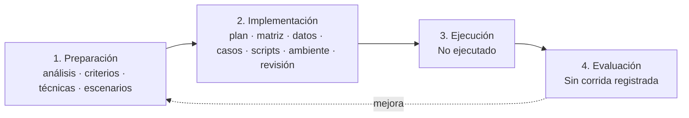

# Flujo metodológico del proceso de pruebas · HU-005 Cerrar la sesión

[Portada](README.md) · [Nomenclatura](00_Nomenclatura.md)



## Cadena de trazabilidad

```text
HU-005 / RF-005 → CA-HU-005-01 a 04 + RNF-002, RNF-004, RNF-005
→ ESC-ACC-CIE-001 … 008 → ACC-CIE-001 … 008 → SCR-ACC-CIE-001 … 008
→ Ejecución → resultado observado → incidencia → informe → mejora (pendiente)
```

## Fases y puntos de control

| Fase | Insumos | Salidas |
|---|---|---|
| 1. Preparación | HU-005, RF-005, CA, RNF-002/004/005, dependencias HU-002/HU-008 | [Análisis](01_Preparacion/1.1_Analisis_de_la_HU.md) · [Criterios](01_Preparacion/1.2_Criterios_de_aceptacion.md) · [Técnicas](01_Preparacion/1.3_Tipos_y_tecnicas_de_prueba.md) · [Escenarios](01_Preparacion/1.4_Escenarios_de_prueba.md) |
| 2. Implementación | Escenarios, preguntas y estados iniciales | [Plan](02_Implementacion/2.1_Plan_de_pruebas.md) · [Matriz](02_Implementacion/2.2_Matriz_de_trazabilidad.md) · [Datos](02_Implementacion/2.3_Datos_de_prueba.md) · [Casos](02_Implementacion/2.4_Casos_de_prueba/00_Indice_de_casos.md) · [Scripts](02_Implementacion/2.5_Scripts_de_prueba/) · [Ambiente](02_Implementacion/2.6_Ambiente_de_pruebas.md) · [Revisión](02_Implementacion/2.7_Revision_por_pares.md) |
| 3. Ejecución | Banco revisado y ambiente | [Preparación](03_Ejecucion/3.1_Preparacion_de_la_ejecucion.md) · [Registro](03_Ejecucion/3.2_Registro_de_ejecucion.md) |
| 4. Evaluación | Corrida real | [Incidencias](04_Evaluacion/4.1_Gestion_de_incidencias.md) · [Informe](04_Evaluacion/4.2_Informe_de_resultados.md) · [Mejora](04_Evaluacion/4.3_Plan_de_mejora_continua.md) |

Preparación → implementación requiere cobertura trazable; implementación → ejecución requiere revisión por pares y datos reproducibles; ejecución → evaluación requiere resultados observados; cierre requiere incidencias verificadas.

## Ubicación en Scrum

| Evento | Actividad |
|---|---|
| Refinamiento | Resolver PA-01 a PA-07 con PO. |
| Sprint Planning / Sprint | Diseñar artefactos en `qa/hu-005`. |
| Revisión por pares | Grupo 5 revisa la PR con lista 2.7. |
| Sprint Review | Presentar banco; resultados se agregan solo tras ejecutar. |
| Retrospective | Acordar mejoras en 4.3. |

El orden de elaboración no es el orden de ejecución. No se ha realizado una corrida.
