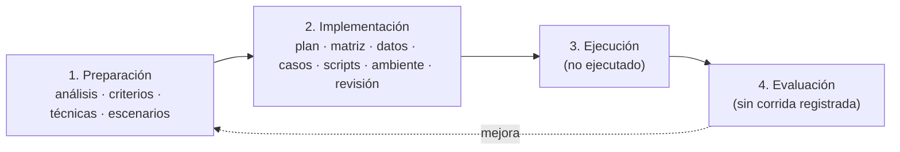

# Flujo metodológico del proceso de pruebas · HU-006 Finalizar una sesión inválida

[Portada](README.md) · [Nomenclatura y codificación](00_Nomenclatura.md)

Este flujo organiza el proceso de pruebas de **HU-006 Finalizar una sesión inválida** en **cuatro fases**. Cada fase recibe insumos, realiza actividades y entrega artefactos que alimentan la siguiente. En esta evidencia (EV05) se completan las fases 1 y 2; las fases 3 y 4 quedan preparadas y **sin ejecución** para el Tema 6.



## Cadena de trazabilidad

```text
HU-006 / RF-006
   ↓  4 criterios de aceptación (Dado–Cuando–Entonces) + 1 condición de calidad de la ficha (RNF-002)
Escenarios ESC-ACC-INV-001 … 004  (básico, alternos, excepciones, calidad)
   ↓
Casos ACC-INV-001 … 004  → qué se comprueba
   ↓
Scripts SCR-ACC-INV-001 … 004  → cómo se comprueba
   ↓
Ejecución → resultado real → incidencia → reprueba → informe → mejora   (pendiente: Tema 6)
```

## Fases, actividades y artefactos

| Fase | Insumos | Actividades | Artefactos de salida |
|---|---|---|---|
| **1. Preparación** | Ficha de HU-006, reglas RN-001 y RN-002, condiciones RNF-002, RNF-004 y RNF-005, dependencias HU-002, HU-008, HU-028 y uso posterior en HU-004 | Analizar la historia; descomponer cada criterio en condiciones; registrar vacíos como preguntas al Product Owner; clasificar el tipo de prueba y elegir técnicas; generar escenarios | [1.1 Análisis](01_Preparacion/1.1_Analisis_de_la_HU.md) · [1.2 Criterios](01_Preparacion/1.2_Criterios_de_aceptacion.md) · [1.3 Tipos y técnicas](01_Preparacion/1.3_Tipos_y_tecnicas_de_prueba.md) · [1.4 Escenarios](01_Preparacion/1.4_Escenarios_de_prueba.md) |
| **2. Implementación** | Escenarios, técnicas, preguntas registradas | Redactar el plan; construir la matriz; preparar datos concretos; redactar un caso y un script por escenario; definir el ambiente; preparar la revisión por pares | [2.1 Plan](02_Implementacion/2.1_Plan_de_pruebas.md) · [2.2 Matriz](02_Implementacion/2.2_Matriz_de_trazabilidad.md) · [2.3 Datos](02_Implementacion/2.3_Datos_de_prueba.md) · [2.4 Casos](02_Implementacion/2.4_Casos_de_prueba/00_Indice_de_casos.md) · [2.5 Scripts](02_Implementacion/2.5_Scripts_de_prueba/) · [2.6 Ambiente](02_Implementacion/2.6_Ambiente_de_pruebas.md) · [2.7 Revisión por pares](02_Implementacion/2.7_Revision_por_pares.md) |
| **3. Ejecución** | Banco revisado, ambiente, versión del producto | Planificar el calendario; verificar el entorno; integrar datos; evaluar criterios de entrada; ejecutar scripts y registrar resultados | [3.1 Preparación de la ejecución](03_Ejecucion/3.1_Preparacion_de_la_ejecucion.md) · [3.2 Registro de ejecución](03_Ejecucion/3.2_Registro_de_ejecucion.md) |
| **4. Evaluación** | Resultados reales, evidencias | Analizar fallos; reportar y seguir incidencias; reprobar; consolidar el informe; proponer mejoras | [4.1 Incidencias](04_Evaluacion/4.1_Gestion_de_incidencias.md) · [4.2 Informe](04_Evaluacion/4.2_Informe_de_resultados.md) · [4.3 Mejora continua](04_Evaluacion/4.3_Plan_de_mejora_continua.md) |

## Puntos de control entre fases

| Paso | Pregunta de control | Si la respuesta es «no» |
|---|---|---|
| Preparación → Implementación | ¿Cada criterio de HU-006 tiene condiciones observables y las dudas están resueltas o registradas (PA-01 a PA-04)? | Volver al análisis y llevar la duda al refinamiento con el Product Owner. |
| Implementación → Ejecución | ¿Cada escenario tiene caso, script y datos, y la revisión por pares del Grupo 5 está cerrada? | Ajustar los artefactos observados antes de pedir la versión de ensayo. |
| Ejecución → Evaluación | ¿Todos los casos tienen un estado registrado en una corrida? | Completar la corrida o registrar el bloqueo. |
| Evaluación → Cierre | ¿Las incidencias que impiden cumplir un criterio están verificadas y cerradas? | Reprobar en una nueva corrida. |

## Ubicación del flujo dentro de Scrum

| Evento o artefacto Scrum | Fase de pruebas | Qué se hace con HU-006 |
|---|---|---|
| Refinamiento del Product Backlog | 1. Preparación | Revisar los 4 criterios, llevar las preguntas PA-01 a PA-04 al instructor (PO) mediante el [acta de refinamiento](../../Sprint_1/Acta_de_refinamiento.md) y acordar escenarios. |
| Sprint Planning | 2. Implementación (plan) | Incluir las tareas de diseño de HU-006 en el [Sprint Backlog QA](../../Sprint_1/Sprint_Backlog_QA.md) según la [estimación](../../Sprint_1/Estimacion_QA_HU-006.md) y la capacidad. |
| Durante el Sprint (Daily Scrum) | 2 | Redactar casos y scripts, preparar datos y ambiente, mover la issue de HU-006 en el tablero y abrir la PR de la rama `qa/hu-006`. |
| Revisión por pares (PR) | 2.7 | El Grupo 5 revisa la PR con la lista de [2.7](02_Implementacion/2.7_Revision_por_pares.md); se aplican ajustes antes de fusionar. |
| Definición de Terminado del diseño | Criterios de salida del diseño | HU-006 queda diseñada cuando cumple el [DoD del diseño](../../00_Organizacion/DoD.md): cobertura trazable, scripts reproducibles, revisión ajena resuelta y enlaces accesibles. |
| Sprint Review | 4. Evaluación (informe) | En esta evidencia se presenta el banco diseñado; el informe con resultados se diligencia en el Tema 6. |
| Sprint Retrospective | 4. Evaluación (mejora) | Revisar cómo se trabajó el diseño y acordar acciones del [plan de mejora](04_Evaluacion/4.3_Plan_de_mejora_continua.md). |

**Orden de elaboración ≠ orden de ejecución.** Las fases indican qué documento se construye primero. El orden de ejecución de los casos está en [3.1](03_Ejecucion/3.1_Preparacion_de_la_ejecucion.md).